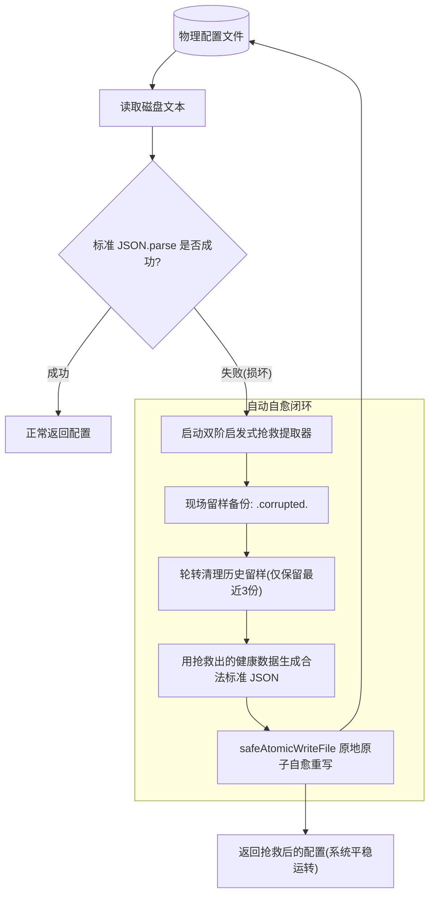

# 配置韧性、启发式损坏提取与崩溃安全自愈架构 (Config Resilience & Atomic Self-Healing)

在长周期常驻的 DSH 插件运行时环境中，插件私有的本地持久化文件（如回退配置 `config.json`、跨进程会话状态表、自定义缓存文件等）不可避免地面临系统意外掉电、操作系统强制杀死进程（SIGKILL）、磁盘瞬态 I/O 抖动或外部人工手改格式错误等物理挑战。

若缺乏工业级的容灾与自愈设计，往往会引发两类严重的体验灾难：
1. **写盘半截断灾难**：直接调用 `writeFileSync` 覆写文件，在写入中途被杀，留下 0 字节或半截断的坏文件；
2. **粗暴重置灾难**：读取侧仅使用简单 `try { JSON.parse() } catch { return {} }`，一旦文件语法被破坏，便将用户长期累积的关键配置或会话基线彻底丢弃清空。

本专题系统性总结一套放之所有 DSH 插件皆准的**配置韧性与自动自愈通用架构模式**。

---

## 一、崩溃安全原子写盘模式 (Crash-Safe Atomic Write)

### 1. 物理机理与隐患
直接调用操作系统的写文件接口修改原文件（In-place Overwrite）不是原子操作。如果在操作系统把缓冲区刷入磁盘的过程中发生崩溃或断电，原有文件已被截断（Truncated）而新数据尚未完全写入，物理文件将永久损坏。

### 2. 标准实现范式：Temp + Atomic Rename
利用 POSIX 与 Windows 文件系统提供的系统级原子操作 `rename`，确保磁盘上要么是完整的旧文件、要么是完整的新文件，中间态对外部不可见：

```ts
import { existsSync, mkdirSync, renameSync, unlinkSync, writeFileSync } from 'node:fs'
import { basename, dirname, join } from 'node:path'

/**
 * 崩溃安全原子写盘
 * 适用于配置文件、状态缓存与任何私有 JSON 物理持久化
 */
export function safeAtomicWriteFile(filePath: string, content: string): boolean {
  const dir = dirname(filePath)
  try {
    mkdirSync(dir, { recursive: true })
  } catch {
    // 忽略目录已存在
  }

  // 1. 生成同目录下的进程级唯一临时文件（必须同目录，杜绝跨卷重命名失败）
  const tmpPath = join(
    dir,
    `.tmp.${basename(filePath)}.${process.pid}.${Date.now()}.${Math.random().toString(36).slice(2, 6)}`,
  )

  try {
    // 2. 将完整内容完整写入临时文件
    writeFileSync(tmpPath, content, 'utf8')
    try {
      // 3. 原子重命名覆盖目标路径
      renameSync(tmpPath, filePath)
      return true
    } catch {
      // 4. Windows 极端文件占用锁降级兜底：若 rename 被锁，安全回退直写并清理临时文件
      writeFileSync(filePath, content, 'utf8')
      try {
        unlinkSync(tmpPath)
      } catch {
        // ignore
      }
      return true
    }
  } catch {
    // 5. 异常清理，杜绝残留孤儿临时文件
    try {
      if (existsSync(tmpPath)) unlinkSync(tmpPath)
    } catch {
      // ignore
    }
    return false
  }
}
```

### 3. 铁律准则
- **临时文件必须与目标文件在同一个父目录**：绝不能写在全局系统临时目录（如 `/tmp` 或 `C:\Temp`），跨文件系统分区的 `renameSync` 会退化为 `copy + delete`，失去原子性并可能因跨设备抛出 `EXDEV` 错误；
- **文件名必须混入 PID、时间戳与随机串**：防止多进程或高并发测试同时写盘时发生临时文件名冲突碰撞。

---

## 二、启发式多阶配置抢救提取流水线 (Heuristic Salvage Pipeline)

当物理文件被截断或损坏导致标准 `JSON.parse` 抛出异常时，严禁直接返回空白默认对象！绝大多数文件损坏只是丢失了末尾闭合符号、悬挂了逗号、或混入了少量乱码，核心键值依然完整存在于文本中。

必须建立**双阶启发式抢救提取器**：

```ts
export interface SalvageResult<T> {
  salvaged: boolean             // 是否发生损坏并成功抢救
  data: T                       // 抢救并归一化后的核心结构体
  recoveredFields: Record<string, unknown> // 抢救出的所有原始键值（保全未知扩展键）
}

export function salvageJsonConfig<T>(
  raw: string,
  normalizer: (fields: Record<string, unknown>) => T,
  fallbackDefaults: T,
): SalvageResult<T> {
  const clean = String(raw ?? '').replace(/^\uFEFF/, '').trim()
  if (!clean) {
    return { salvaged: false, data: fallbackDefaults, recoveredFields: {} }
  }

  // ==========================================
  // 第一阶：轻度语法自动修补 (Syntax Healing)
  // ==========================================
  try {
    // 1. 清除对象与数组末尾非法的悬挂逗号（JSON 常见破坏点）：, } -> }  以及 , ] -> ]
    let healed = clean.replace(/,\s*([}\]])/g, '$1')

    // 2. 统计大括号与中括号不平衡（截断写入常见破坏点：缺失闭合括号）
    let openBraces = 0, closeBraces = 0
    let openBrackets = 0, closeBrackets = 0
    let inString = false, escaped = false

    for (let i = 0; i < healed.length; i++) {
      const char = healed[i]
      if (escaped) { escaped = false; continue }
      if (char === '\\') { escaped = true; continue }
      if (char === '"') { inString = !inString; continue }
      if (!inString) {
        if (char === '{') openBraces++
        else if (char === '}') closeBraces++
        else if (char === '[') openBrackets++
        else if (char === ']') closeBrackets++
      }
    }

    // 3. 自动补齐末尾缺失的闭合括号
    if (openBrackets > closeBrackets) healed += ']'.repeat(openBrackets - closeBrackets)
    if (openBraces > closeBraces) healed += '}'.repeat(openBraces - closeBraces)

    const parsed = JSON.parse(healed)
    if (parsed && typeof parsed === 'object' && !Array.isArray(parsed)) {
      const fields = parsed as Record<string, unknown>
      return {
        salvaged: true,
        data: normalizer(fields),
        recoveredFields: fields,
      }
    }
  } catch {
    // 第一阶修补未通过，平滑进入第二阶正则深度抢救
  }

  // ==========================================
  // 第二阶：字段级正则模式深度抢救 (Pattern Salvage)
  // ==========================================
  const recovered: Record<string, unknown> = {}

  // 1. 扫描抢救标准标量键值对（支持字符串、布尔、数字、null）
  const scalarRegex = /"([a-zA-Z0-9_-]+)"\s*:\s*("(?:[^"\\]|\\.)*"|true|false|null|-?\d+(?:\.\d+)?)/g
  let match: RegExpExecArray | null
  while ((match = scalarRegex.exec(clean)) !== null) {
    const key = match[1]
    const valRaw = match[2]
    if (key && valRaw && !Object.hasOwn(recovered, key)) {
      try {
        recovered[key] = JSON.parse(valRaw)
      } catch {
        // ignore
      }
    }
  }

  // 2. 针对常见数组列表字段专项抢救（即便数组未闭合也能捞出已知元素）
  const arrayFieldRegex = /"([a-zA-Z0-9_-]+)"\s*:\s*\[([\s\S]*?)(\]|$)/g
  let arrMatch: RegExpExecArray | null
  while ((arrMatch = arrayFieldRegex.exec(clean)) !== null) {
    const arrKey = arrMatch[1]
    const arrBody = arrMatch[2]
    if (arrKey && arrBody) {
      const items: string[] = []
      const itemRegex = /"([^"]+)"/g
      let itemMatch: RegExpExecArray | null
      while ((itemMatch = itemRegex.exec(arrBody)) !== null) {
        if (itemMatch[1]) items.push(itemMatch[1])
      }
      recovered[arrKey] = items
    }
  }

  const hasContent = Object.keys(recovered).length > 0
  return {
    salvaged: hasContent,
    data: hasContent ? normalizer(recovered) : fallbackDefaults,
    recoveredFields: recovered,
  }
}
```

---

## 三、现场留样备份与自动自愈重新生成机制 (Auto-Regeneration)

抢救出配置后，若仅在内存中恢复生效而放任磁盘文件继续损坏，后续其他外部工具、独立子进程或下次启动直读时仍然会报错。

必须形成**现场留样备份 -> 自动重写合法文件**的完整自愈闭环：



### 1. 现场留样备份与轮转算法
避免无限制生成备份文件吃满磁盘，引入常数上限轮转机制（如保留最近 3 份）：

```ts
const MAX_CORRUPTED_BACKUPS = 3

function backupCorruptedFile(filePath: string, content: string): void {
  try {
    const dir = dirname(filePath)
    const base = basename(filePath)
    const backupPath = join(dir, `${base}.corrupted.${Date.now()}`)
    writeFileSync(backupPath, content, 'utf8')

    // 轮转清理：仅保留最近 MAX 份
    try {
      const files = readdirSync(dir)
      const corruptedFiles = files
        .filter((f) => f.startsWith(`${base}.corrupted.`))
        .sort()
      if (corruptedFiles.length > MAX_CORRUPTED_BACKUPS) {
        const toDelete = corruptedFiles.slice(0, corruptedFiles.length - MAX_CORRUPTED_BACKUPS)
        for (const f of toDelete) {
          try { unlinkSync(join(dir, f)) } catch { /* ignore */ }
        }
      }
    } catch {
      // ignore
    }
  } catch {
    // 留样失败不阻断核心自愈流程
  }
}
```

### 2. 读侧自愈重写触发
在 `readDiskConfig` 核心函数中闭环自愈：
```ts
export function readDiskConfig(targetPath: string): AppConfig {
  const raw = readFileSafe(targetPath)
  if (!raw) return DEFAULT_CONFIG

  try {
    return JSON.parse(raw)
  } catch {
    // 1. 标准解析失败，启动抢救
    const salvaged = salvageJsonConfig(raw, normalizeConfig, DEFAULT_CONFIG)
    
    // 2. 现场留样备份损坏文件
    backupCorruptedFile(targetPath, raw)
    
    // 3. 原地自动自愈重写为合法的标准 JSON
    const regenerated = {
      ...salvaged.recoveredFields,
      ...salvaged.data,
    }
    safeAtomicWriteFile(targetPath, JSON.stringify(regenerated, null, 2))
    
    // 4. 返回抢救后的健康配置，系统无感平滑运转
    return salvaged.data
  }
}
```

---

## 四、会话状态持久化双重自愈模式

对于维护多会话基线锁定（保护长会话 KV Cache 零破坏）的插件，其会话状态文件（如 `session-states.json`）同样适用本套自愈模式：

1. **半截断提取容错**：写入可能在第二个会话对象内部被强杀截断，正则匹配必须允许没有右大括号闭合结尾（`/"([^"]+)"\s*:\s*\{([^}]*(?:\}|$))/g`）；
2. **基线优先保全**：只要从坏块中能提取出 `sessionId` 与 `baselineMode`，就立即重建该会话条目并自愈重写磁盘文件，防止用户多轮累积的历史前缀缓存发生崩塌式的 Cache Miss。

---

## 五、破坏注入测试设计范式 (Chaos & Invariant Tests)

每一个自愈模块必须配备严格的自动化破坏注入单测，守卫 3 大不变性断言：

```ts
test('配置韧性自愈: 极端损坏文本抢救、留样备份与合法重生成', async () => {
  // 1. 构造极端破损文本（如结尾缺失大括号且悬挂逗号）
  const corrupted = '{\n  "featureA": "enabled",\n  "whiteList": ["alpha", "beta"],\n  "corrupted": '
  await writeFile(testConfigPath, corrupted, 'utf8')

  // 2. 执行读取
  const result = readDiskConfig(testConfigPath)

  // 断言 1: 数据被完整抢救提取
  assert.equal(result.featureA, 'enabled')
  assert.deepEqual(result.whiteList, ['alpha', 'beta'])

  // 断言 2: 磁盘上的文件自动恢复为合法标准 JSON
  const repairedRaw = await readFile(testConfigPath, 'utf8')
  assert.doesNotThrow(() => JSON.parse(repairedRaw), '磁盘文件必须被自愈重写为合法 JSON')

  // 断言 3: 磁盘生成了留样备份文件且内容与损坏现场一致
  const backups = (await readdir(testDir)).filter(f => f.includes('.corrupted.'))
  assert.equal(backups.length, 1)
  assert.equal(await readFile(join(testDir, backups[0]), 'utf8'), corrupted)
})
```
