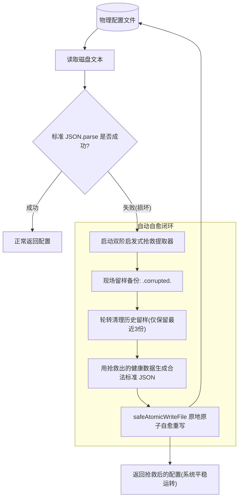

# 配置韧性、启发式损坏提取与崩溃安全自愈架构 (Config Resilience & Atomic Self-Healing)

在长周期常驻的 DSH 插件运行时环境中，插件私有的本地持久化文件（如回退配置 `config.json`、跨进程会话状态表、自定义缓存文件等）不可避免地面临系统意外掉电、操作系统强制杀死进程（SIGKILL）、磁盘瞬态 I/O 抖动或外部人工手改格式错误等物理挑战。

若缺乏工业级的容灾与自愈设计，往往会引发两类严重的体验灾难：
1. **写盘半截断灾难**：直接调用 `writeFileSync` 覆写文件，在写入中途被杀，留下 0 字节或半截断的坏文件；
2. **粗暴重置灾难**：读取侧仅使用简单 `try { JSON.parse() } catch { return {} }`，一旦文件语法被破坏，便将用户长期累积的关键配置或会话基线彻底丢弃清空。

本专题系统性总结一套放之所有 DSH 插件皆准的**配置韧性与自动自愈通用架构模式**。

---

## 一、崩溃安全原子写盘模式 (Crash-Safe Atomic Write)

### 1. 物理机理与隐患
直接调用操作系统的写文件接口修改原文件（In-place Overwrite）不是原子操作。如果在操作系统把缓冲区刷入磁盘的过程中发生崩溃或断电，原有文件已被截断（Truncated）而新数据尚未完全写入，物理文件将永久损坏。

### 2. 标准实现范式：Temp + Atomic Rename
利用 POSIX 与 Windows 文件系统提供的系统级原子操作 `rename`，确保磁盘上要么是完整的旧文件、要么是完整的新文件，中间态对外部不可见：

```ts
import { existsSync, mkdirSync, renameSync, unlinkSync, writeFileSync } from 'node:fs'
import { basename, dirname, join } from 'node:path'

/**
 * 崩溃安全原子写盘
 * 适用于配置文件、状态缓存与任何私有 JSON 物理持久化
 */
export function safeAtomicWriteFile(filePath: string, content: string): boolean {
  const dir = dirname(filePath)
  try {
    mkdirSync(dir, { recursive: true })
  } catch {
    // 忽略目录已存在
  }

  // 1. 生成同目录下的进程级唯一临时文件（必须同目录，杜绝跨卷重命名失败）
  const tmpPath = join(
    dir,
    `.tmp.${basename(filePath)}.${process.pid}.${Date.now()}.${Math.random().toString(36).slice(2, 6)}`,
  )

  try {
    // 2. 将完整内容完整写入临时文件
    writeFileSync(tmpPath, content, 'utf8')
    try {
      // 3. 原子重命名覆盖目标路径
      renameSync(tmpPath, filePath)
      return true
    } catch {
      // 4. Windows 极端文件占用锁降级兜底：若 rename 被锁，安全回退直写并清理临时文件
      writeFileSync(filePath, content, 'utf8')
      try {
        unlinkSync(tmpPath)
      } catch {
        // ignore
      }
      return true
    }
  } catch {
    // 5. 异常清理，杜绝残留孤儿临时文件
    try {
      if (existsSync(tmpPath)) unlinkSync(tmpPath)
    } catch {
      // ignore
    }
    return false
  }
}
```

### 3. 铁律准则
- **临时文件必须与目标文件在同一个父目录**：绝不能写在全局系统临时目录（如 `/tmp` 或 `C:\Temp`），跨文件系统分区的 `renameSync` 会退化为 `copy + delete`，失去原子性并可能因跨设备抛出 `EXDEV` 错误；
- **文件名必须混入 PID、时间戳与随机串**：防止多进程或高并发测试同时写盘时发生临时文件名冲突碰撞。

---

## 二、启发式多阶配置抢救提取流水线 (Heuristic Salvage Pipeline)

当物理文件被截断或损坏导致标准 `JSON.parse` 抛出异常时，严禁直接返回空白默认对象！绝大多数文件损坏只是丢失了末尾闭合符号、悬挂了逗号、或混入了少量乱码，核心键值依然完整存在于文本中。

必须建立**双阶启发式抢救提取器**：

```ts
export interface SalvageResult<T> {
  salvaged: boolean             // 是否发生损坏并成功抢救
  data: T                       // 抢救并归一化后的核心结构体
  recoveredFields: Record<string, unknown> // 抢救出的所有原始键值（保全未知扩展键）
}

export function salvageJsonConfig<T>(
  raw: string,
  normalizer: (fields: Record<string, unknown>) => T,
  fallbackDefaults: T,
): SalvageResult<T> {
  const clean = String(raw ?? '').replace(/^\uFEFF/, '').trim()
  if (!clean) {
    return { salvaged: false, data: fallbackDefaults, recoveredFields: {} }
  }

  // ==========================================
  // 第一阶：轻度语法自动修补 (Syntax Healing)
  // ==========================================
  try {
    // 1. 清除对象与数组末尾非法的悬挂逗号（JSON 常见破坏点）：, } -> }  以及 , ] -> ]
    let healed = clean.replace(/,\s*([}\]])/g, '$1')

    // 2. 统计大括号与中括号不平衡（截断写入常见破坏点：缺失闭合括号）
    let openBraces = 0, closeBraces = 0
    let openBrackets = 0, closeBrackets = 0
    let inString = false, escaped = false

    for (let i = 0; i < healed.length; i++) {
      const char = healed[i]
      if (escaped) { escaped = false; continue }
      if (char === '\\') { escaped = true; continue }
      if (char === '"') { inString = !inString; continue }
      if (!inString) {
        if (char === '{') openBraces++
        else if (char === '}') closeBraces++
        else if (char === '[') openBrackets++
        else if (char === ']') closeBrackets++
      }
    }

    // 3. 自动补齐末尾缺失的闭合括号
    if (openBrackets > closeBrackets) healed += ']'.repeat(openBrackets - closeBrackets)
    if (openBraces > closeBraces) healed += '}'.repeat(openBraces - closeBraces)

    const parsed = JSON.parse(healed)
    if (parsed && typeof parsed === 'object' && !Array.isArray(parsed)) {
      const fields = parsed as Record<string, unknown>
      return {
        salvaged: true,
        data: normalizer(fields),
        recoveredFields: fields,
      }
    }
  } catch {
    // 第一阶修补未通过，平滑进入第二阶正则深度抢救
  }

  // ==========================================
  // 第二阶：字段级正则模式深度抢救 (Pattern Salvage)
  // ==========================================
  const recovered: Record<string, unknown> = {}

  // 1. 扫描抢救标准标量键值对（支持字符串、布尔、数字、null）
  const scalarRegex = /"([a-zA-Z0-9_-]+)"\s*:\s*("(?:[^"\\]|\\.)*"|true|false|null|-?\d+(?:\.\d+)?)/g
  let match: RegExpExecArray | null
  while ((match = scalarRegex.exec(clean)) !== null) {
    const key = match[1]
    const valRaw = match[2]
    if (key && valRaw && !Object.hasOwn(recovered, key)) {
      try {
        recovered[key] = JSON.parse(valRaw)
      } catch {
        // ignore
      }
    }
  }

  // 2. 针对常见数组列表字段专项抢救（即便数组未闭合也能捞出已知元素）
  const arrayFieldRegex = /"([a-zA-Z0-9_-]+)"\s*:\s*\[([\s\S]*?)(\]|$)/g
  let arrMatch: RegExpExecArray | null
  while ((arrMatch = arrayFieldRegex.exec(clean)) !== null) {
    const arrKey = arrMatch[1]
    const arrBody = arrMatch[2]
    if (arrKey && arrBody) {
      const items: string[] = []
      const itemRegex = /"([^"]+)"/g
      let itemMatch: RegExpExecArray | null
      while ((itemMatch = itemRegex.exec(arrBody)) !== null) {
        if (itemMatch[1]) items.push(itemMatch[1])
      }
      recovered[arrKey] = items
    }
  }

  const hasContent = Object.keys(recovered).length > 0
  return {
    salvaged: hasContent,
    data: hasContent ? normalizer(recovered) : fallbackDefaults,
    recoveredFields: recovered,
  }
}
```

---

## 三、现场留样备份与自动自愈重新生成机制 (Auto-Regeneration)

抢救出配置后，若仅在内存中恢复生效而放任磁盘文件继续损坏，后续其他外部工具、独立子进程或下次启动直读时仍然会报错。

必须形成**现场留样备份 -> 自动重写合法文件**的完整自愈闭环：



### 1. 现场留样备份与轮转算法
避免无限制生成备份文件吃满磁盘，引入常数上限轮转机制（如保留最近 3 份）：

```ts
const MAX_CORRUPTED_BACKUPS = 3

function backupCorruptedFile(filePath: string, content: string): void {
  try {
    const dir = dirname(filePath)
    const base = basename(filePath)
    const backupPath = join(dir, `${base}.corrupted.${Date.now()}`)
    writeFileSync(backupPath, content, 'utf8')

    // 轮转清理：仅保留最近 MAX 份
    try {
      const files = readdirSync(dir)
      const corruptedFiles = files
        .filter((f) => f.startsWith(`${base}.corrupted.`))
        .sort()
      if (corruptedFiles.length > MAX_CORRUPTED_BACKUPS) {
        const toDelete = corruptedFiles.slice(0, corruptedFiles.length - MAX_CORRUPTED_BACKUPS)
        for (const f of toDelete) {
          try { unlinkSync(join(dir, f)) } catch { /* ignore */ }
        }
      }
    } catch {
      // ignore
    }
  } catch {
    // 留样失败不阻断核心自愈流程
  }
}
```

### 2. 读侧自愈重写触发
在 `readDiskConfig` 核心函数中闭环自愈：
```ts
export function readDiskConfig(targetPath: string): AppConfig {
  const raw = readFileSafe(targetPath)
  if (!raw) return DEFAULT_CONFIG

  try {
    return JSON.parse(raw)
  } catch {
    // 1. 标准解析失败，启动抢救
    const salvaged = salvageJsonConfig(raw, normalizeConfig, DEFAULT_CONFIG)
    
    // 2. 现场留样备份损坏文件
    backupCorruptedFile(targetPath, raw)
    
    // 3. 原地自动自愈重写为合法的标准 JSON
    const regenerated = {
      ...salvaged.recoveredFields,
      ...salvaged.data,
    }
    safeAtomicWriteFile(targetPath, JSON.stringify(regenerated, null, 2))
    
    // 4. 返回抢救后的健康配置，系统无感平滑运转
    return salvaged.data
  }
}
```

---

## 四、会话状态持久化双重自愈模式

对于维护多会话基线锁定（保护长会话 KV Cache 零破坏）的插件，其会话状态文件（如 `session-states.json`）同样适用本套自愈模式：

1. **半截断提取容错**：写入可能在第二个会话对象内部被强杀截断，正则匹配必须允许没有右大括号闭合结尾（`/"([^"]+)"\s*:\s*\{([^}]*(?:\}|$))/g`）；
2. **基线优先保全**：只要从坏块中能提取出 `sessionId` 与 `baselineMode`，就立即重建该会话条目并自愈重写磁盘文件，防止用户多轮累积的历史前缀缓存发生崩塌式的 Cache Miss。

---

## 五、破坏注入测试设计范式 (Chaos & Invariant Tests)

每一个自愈模块必须配备严格的自动化破坏注入单测，守卫 3 大不变性断言：

```ts
test('配置韧性自愈: 极端损坏文本抢救、留样备份与合法重生成', async () => {
  // 1. 构造极端破损文本（如结尾缺失大括号且悬挂逗号）
  const corrupted = '{\n  "featureA": "enabled",\n  "whiteList": ["alpha", "beta"],\n  "corrupted": '
  await writeFile(testConfigPath, corrupted, 'utf8')

  // 2. 执行读取
  const result = readDiskConfig(testConfigPath)

  // 断言 1: 数据被完整抢救提取
  assert.equal(result.featureA, 'enabled')
  assert.deepEqual(result.whiteList, ['alpha', 'beta'])

  // 断言 2: 磁盘上的文件自动恢复为合法标准 JSON
  const repairedRaw = await readFile(testConfigPath, 'utf8')
  assert.doesNotThrow(() => JSON.parse(repairedRaw), '磁盘文件必须被自愈重写为合法 JSON')

  // 断言 3: 磁盘生成了留样备份文件且内容与损坏现场一致
  const backups = (await readdir(testDir)).filter(f => f.includes('.corrupted.'))
  assert.equal(backups.length, 1)
  assert.equal(await readFile(join(testDir, backups[0]), 'utf8'), corrupted)
})
```

---

## 六、YAML 补丁与组合层 (Bundle Patch / Cordis Patch) 的物理损坏提取与自愈模型

在 DSH 插件体系中，很多插件以 Bundle 组合包形态分发，通过 `cordis.patch.yml` 或 `cordis.yml` 向宿主注入插件行与工具依赖。与私有 JSON 文件相比，YAML 格式在物理破坏下具有完全不同的破坏特征与更严峻的脆弱性。

### 1. YAML 格式的物理破坏三大特征
1. **缩进敏感与制表符破坏**：断电、截断或外部手动编辑极易引入缩进错位或制表符 Tab，直接引发 `YAMLParseError` 导致宿主 Loader 崩溃无法启动；
2. **截断写入引发的「Null 毒丸」伪正常解析**：
   当物理写盘在写入列表项中途截断（例如截断在 `- `），标准 YAML 解析器**不会抛出语法错误**，而是将未完成的空项目静默解析为 `null`！
   若后续逻辑直接使用该数组，未进行非空与类型防御，就会在执行 `item.trim()` 或 `item.toLowerCase()` 时爆发未捕获的空指针异常（`TypeError: Cannot read properties of null`）；
3. **未闭合的内联容器**：如 `disabledList: [itemA, itemB` 缺失闭合中括号引发不可恢复解析异常。

### 2. 双阶段 YAML 容错抢救范式 (Two-Phase YAML Salvage)

```ts
import { parse } from 'yaml'

export interface ExtractedPatchConfig {
  pluginConfig: Record<string, unknown>
  upstreamConfig: Record<string, unknown>
  repairs: string[]
}

/**
 * 清洗并验证字符串列表，坚决杜绝截断引入的 null 毒丸与非法元素
 */
export function sanitizeStringList(raw: unknown, validator?: (v: string) => boolean): string[] {
  if (!Array.isArray(raw)) return []
  const result: string[] = []
  const seen = new Set<string>()
  for (const item of raw) {
    if (typeof item === 'string') {
      const trimmed = item.trim()
      if (trimmed.length > 0 && (!validator || validator(trimmed))) {
        if (!seen.has(trimmed)) {
          seen.add(trimmed)
          result.push(trimmed)
        }
      }
    }
  }
  return result
}

/**
 * YAML 补丁损坏提取器
 */
export function extractCorruptedYamlPatch(corruptedText: string): ExtractedPatchConfig {
  const repairs: string[] = []
  const clean = String(corruptedText ?? '').replace(/^\uFEFF/, '').trim()

  // 阶段一：尝试宽松标准解析
  try {
    const parsed = parse(clean)
    if (parsed && typeof parsed === 'object') {
      const rows: any[] = []
      if (Array.isArray(parsed)) {
        for (const item of parsed) {
          if (Array.isArray(item?.insert)) rows.push(...item.insert)
          else if (item?.id) rows.push(item)
        }
      } else if (Array.isArray((parsed as any).insert)) {
        rows = (parsed as any).insert
      }

      const pluginConfig: Record<string, unknown> = {}
      const upstreamConfig: Record<string, unknown> = {}

      for (const row of rows) {
        if (!row || typeof row !== 'object') continue
        // 关键防护：对提取出的列表字段必须使用 sanitizeStringList 清洗，消除截断引入的 null
        const cfg = row.config || row
        for (const [k, v] of Object.entries(cfg)) {
          if (Array.isArray(v)) {
            cfg[k] = sanitizeStringList(v)
          }
        }
        if (row.id === '<plugin-id>') Object.assign(pluginConfig, cfg)
        else if (row.id === '<upstream-id>') Object.assign(upstreamConfig, cfg)
      }

      repairs.push('标准 YAML 解析成功，已完成列表元素空值过滤')
      return { pluginConfig, upstreamConfig, repairs }
    }
  } catch (err) {
    repairs.push(`标准 YAML 解析失败 (${(err as Error).message})，切换至行级状态机扫描器`)
  }

  // 阶段二：行级启发式状态机扫描器 (Heuristic Line State Machine)
  return scanCorruptedYamlLines(clean, repairs)
}
```

### 3. 行级启发式状态机扫描器实现要点
当 YAML 语法彻底崩溃时，使用逐行状态机跳过语法垃圾行，专注提取已知键：
- **内联数组提取**：正则匹配 `^(\w+)\s*:\s*\[(.*?)\]`，按逗号切分并调用消毒器；
- **块级列表扫描状态**：当某行匹配 `^(\w+)\s*:$` 时，状态机进入该字段的「列表收集态」；后续遇到 `^\s*-\s*['"]?([^'"]+)['"]?` 时收集元素；当遇到新的冒号键 `^\s*\w+:` 时安全退出列表收集态；
- **标量与枚举提取**：正则匹配 `^(\w+)\s*:\s*['"]?([a-zA-Z0-9_-]+)['"]?`。

---

## 七、运行时内存配置深度体检与宿主持久层 (Settings) 自愈闭环

外部传入的配置不可信。无论是在插件 `apply(ctx, rawConfig)` 入口还是通过 RPC/事件传入的配置对象，都必须进行防御性体检与持久化自愈。

### 1. 懒求值函数防御性展开 (Lazy Function Unrolling)
在 DSH 中，volatile 字段在宿主启动阶段（`app-boot`）常以懒求值函数形式流转（`() => value`）。如果直接使用 `Array.isArray(config.list)` 会因其为函数而判定为 false，造成配置意外丢失；同时必须防范嵌套函数自引用引发死循环栈溢出：

```ts
export function unwrapLazy<T>(raw: unknown, defaultValue: T, maxDepth = 4): T {
  let value: unknown = raw
  for (let i = 0; i < maxDepth && typeof value === 'function'; i += 1) {
    try {
      value = (value as () => unknown)()
    } catch {
      return defaultValue
    }
  }
  return (value === undefined || value === null) ? defaultValue : (value as T)
}
```

### 2. 内存清洗纯函数 (`healConfig`)
- 标量与数字：校验 `Number.isFinite(num)`，对 NaN 或非法值回退为安全默认值；
- 枚举模式：白名单校验，未知字符串优雅回退；
- 列表字段：经过 `sanitizeStringList` 清除脏数据并去重；
- 记录变更明细（`changed: boolean`, `repairs: string[]`）。

### 3. 宿主持久层自动回写自愈闭环 (Persistence Write-Back Loop)
**核心工程洞察**：仅在插件内存中将配置清洗为正常值是不够的！若宿主的持久化配置文件中继续保留损坏或非法的旧字段，每次重启或配置热重载（`settings/document-updated`）时脏配置会再次传入。

**自愈闭环实现范式**：
```ts
export function apply(ctx: Context, rawConfig: PluginConfig): void {
  const { config: healed, changed, repairs } = healConfig(rawConfig)
  if (changed) {
    ctx.logger?.info?.('[plugin] 侦测到非标准或损坏配置，已自动完成自愈清洗: ' + repairs.join('; '))
  }

  // 关键闭环：若检测到清洗修复且宿主 settings 接口可用，自动回写纯净 volatile 字段持久化
  const settings = ctx.settings
  if (changed && settings && typeof settings.update === 'function') {
    void settings.update('<namespace>', {
      loadMode: healed.loadMode,
      enabledItems: healed.enabledItems,
    }).catch(() => {})
  }

  // 后续使用 healed 安全驱动插件核心逻辑
}
```

---

## 八、配置重生成时的反引号嵌套与转义陷阱 (The Backtick Escaping Trap)

### 1. 致命踩坑机制
在自动化重新生成包含动态求值脚本或模板语法的 YAML 补丁时（例如 DSH MCP 客户端授权头中合法的动态求值语法：`Authorization: !!js '`Bearer ${process.env.TOKEN}`'`）：
如果代码生成器在外层使用了 ES6 多行模板字符串（反引号包裹）：
```ts
// 错误示例：反引号嵌套引发静默截断或编译失败！
return `
- insert:
    - id: mcp-client
      config:
        headers:
          Authorization: !!js '`Bearer \${process.env.TOKEN}`'
`
```
**破坏机理**：内层单引号包裹的 **反引号** 会在外层模板字符串解析阶段直接**提前闭合**外层模板字符串！
- TypeScript 编译器会报告：`error TS1005: ';' expected. error TS1434: Unexpected keyword or identifier`；
- 在运行时生成的字符串会在该反引号处被生硬截断，导致配置文件丢失后半截插件定义，宿主加载时爆发不可恢复的语法损坏！

### 2. 彻底根治的最佳实践：行数组隔离生成
严禁在多行模板字符串中直接内嵌未隔离的反引号。一律将特殊行抽取为双引号字符串常量，并使用数组 `join('\n')` 物理隔离：

```ts
export function generateCompliantPatchYaml(options: PatchOptions): string {
  const authHeader = "          Authorization: !!js '`Bearer ${process.env.TOKEN}`'"

  const lines = [
    '# 自动生成的标准 DSH 补丁配置',
    '- insert:',
    '    - id: mcp-client',
    '      name: \'@deepseek-ai/dsh-mcp-client\'',
    '      config:',
    '        url: https://api.example.com/mcp',
    '        headers:',
    authHeader, // 安全无转义冲突
    '        failOnStartupError: false',
    '',
    '    - id: my-plugin',
    '      name: \'<package-name>\'',
    '',
  ]

  return lines.join('\n')
}
```

---

## 九、双面客户端 (Client UI) 防崩溃与防白屏契约

在 DSH 双面插件体系中，客户端半侧（如挂载在 `plugins.row.config` 插槽的 React 表单组件）直接承载用户的开关与配置交互。

### 1. 宿主静默失效陷阱 (Silent Slot Error Trap)
第三方客户端组件运行在宿主的主渲染树中。如果组件内部发生未捕获异常（例如解构 `undefined` 或对非数组使用 `.map()`），宿主外层 ErrorBoundary 会捕获该异常，并将整个插槽渲染为**空的 `<div data-slot-error>`**：
- 控制台通常**没有任何报错提示**；
- 用户端表现为整个配置面板白屏、消失或无法交互；
- 排查成本极高，需要接入 CDP 抓取底层渲染日志。

### 2. 客户端三层防污与降级规范
在组件接收 `form.state` 时，必须实施三层防污隔离：

```ts
// 1. 字典根对象防污：杜绝 null、非对象与数组冒充字典
const state = form?.state
const user = (state?.user && typeof state.user === 'object' && !Array.isArray(state.user) ? state.user : {}) as Record<string, unknown>
const value = (state?.value && typeof state.value === 'object' && !Array.isArray(state.value) ? state.value : {}) as Record<string, unknown>

// 2. 列表字段消毒：严格过滤非字符串，trim 并去空
function strArray(v: unknown): string[] {
  if (!Array.isArray(v)) return []
  return v
    .filter((item): item is string => typeof item === 'string' && item.trim().length > 0)
    .map((item) => item.trim())
}

const disabledItems = strArray(user.disabledItems)
const activeItems = strArray(value.availableItems)

// 3. 枚举状态多级安全降级链
const rawMode = user.mode ?? value.mode
const mode: 'global' | 'preset' = rawMode === 'preset' ? 'preset' : 'global'
```

---

## 十一、通用轻度语法修复纯函数范式 (Generic JSON Syntax Healer)

当复杂插件同时管理多个本地私有持久化 JSON 文件时（例如：主回退配置 `config.json`、多会话隔离状态映射表 `session-states.json`、跨轮次缓存快照等），文件遭遇掉电半截断、末尾缺失闭合符号是跨平台通用的物理现象。

### 1. 架构反模式：各存储模块各自手写修补 (Duplicated Repair)
在每个需要读写 JSON 的模块内部，各自使用内联的循环、栈或手写正则进行括号计数与字段提取。这直接违反了 DRY 原则，造成严重的 **Duplicated Code** 与 **Shotgun Surgery**。一旦需要增强语法清洗规则（如增加转义字符感知或 BOM 头清洗），开发者极易改漏其他存储点。

### 2. 标准工程范式：提取零 I/O 纯函数单一真源
将轻度语法修补逻辑纯化为一个无状态纯函数 `repairJsonSyntax(raw: string): string`，并在通用设置/存储工具模块中导出：

```ts
/**
 * 通用 JSON 语法轻度清洗与未闭合括号对齐补全（自愈第一阶纯函数，零 I/O）
 */
export function repairJsonSyntax(raw: string): string {
  const clean = String(raw ?? '').replace(/^\uFEFF/, '').trim()
  if (!clean) return ''
  // 清除尾部悬挂逗号：, } -> } 以及 , ] -> ]
  let healed = clean.replace(/,\s*([}\]])/g, '$1')
  let openBraces = 0
  let closeBraces = 0
  let openBrackets = 0
  let closeBrackets = 0
  let inString = false
  let escaped = false
  for (let i = 0; i < healed.length; i++) {
    const char = healed[i]
    if (escaped) {
      escaped = false
      continue
    }
    if (char === '\\') {
      escaped = true
      continue
    }
    if (char === '"') {
      inString = !inString
      continue
    }
    if (!inString) {
      if (char === '{') openBraces++
      else if (char === '}') closeBraces++
      else if (char === '[') openBrackets++
      else if (char === ']') closeBrackets++
    }
  }
  // 对称补全缺失的括号
  if (openBrackets > closeBrackets) {
    healed += ']'.repeat(openBrackets - closeBrackets)
  }
  if (openBraces > closeBraces) {
    healed += '}'.repeat(openBraces - closeBraces)
  }
  return healed
}
```

所有管理持久化 JSON 的存储模块，在标准 `JSON.parse` 失败时，第一步均单向调用此通用纯函数尝试语法复苏，消除模块间的代码分化。

---

## 十二、损坏现场留样备份的时序陷阱 (Backup-on-Error Timing Trap)

在实现“语法修补 + 正则模式兜底提取 + 现场留样备份”的多阶自愈管线时，存在一个极其隐蔽的时序逻辑漏洞：

### 1. 致命缺陷：留样备份放错位置
如果将现场留样备份调用（`backupCorruptedFile`）放置在第一阶语法修补之后、第二阶正则抢救之前：

```ts
// 错误示例：留样备份时机滞后！
try {
  return JSON.parse(raw)
} catch {
  try {
    const healed = repairJsonSyntax(raw)
    const parsed = JSON.parse(healed)
    if (parsed) {
      safeAtomicWriteFile(filePath, JSON.stringify(parsed, null, 2))
      return parsed // 致命缺陷：第一阶成功后直接返回，跳过了下方的备份调用！
    }
  } catch {}

  backupCorruptedFile(filePath, raw) // 仅当第一阶语法修补失败时才被执行！
  // ... 正则提取 ...
}
```

**危害分析**：在实际生产中，超过 80% 的损坏场景是掉电导致文件尾部丢失闭合括号 `}`。由于 `repairJsonSyntax` 自愈能力极强，在第一阶就能完美补全并成功解析，直接触发 `return`！结果导致：**文件虽然被原地自愈重写了，但原始损坏现场从未被留样备份**！开发者和运维人员完全无法复盘文件究竟何时、因何被截断破坏。

### 2. 黄金法则：Catch 入口第一时间留样 (Backup First)
只要标准 `JSON.parse(raw)` 抛出 SyntaxError，即板上钉钉证明磁盘上的原始物理文件遭遇了非预期损坏。必须在进入 catch 块的第一行立即执行留样备份，随后再进行第一阶与第二阶的自愈修补：

```ts
// 正确范式：标准解析一旦失败，第一时间留存案发现场
try {
  return JSON.parse(raw)
} catch {
  // 1. 第一步：第一时间现场留样备份原始文件（最多轮转保留 3 份）
  backupCorruptedFile(filePath, raw)

  // 2. 第二步：调用通用语法修补纯函数进行第一阶抢救
  try {
    const healed = repairJsonSyntax(raw)
    const parsed = JSON.parse(healed)
    if (parsed && typeof parsed === 'object') {
      safeAtomicWriteFile(filePath, JSON.stringify(parsed, null, 2))
      return parsed
    }
  } catch {
    // 语法修补未果，进入第三步模式正则提取
  }

  // 3. 第三步：字段级模式正则深度提取 ...
}
```

---

## 十三、清洗文本与留样断言的 Trim 对齐规范 (Normalization vs Exact Assertion)

在读取磁盘文本时，为了防止首尾多余换行符污染后续的流式分析，存储层通常会执行 `const raw = readFileSync(path, 'utf8').trim()`。

### 1. 常见测试断言破裂
当测试用例向文件写入带有尾部换行或缩进空格的损坏文本（如 `const broken = '{\n  "key": "val"\n  '`）时：
- 存储层读取并传入 `backupCorruptedFile(path, raw)` 的是经过 `.trim()` 后的字符串；
- 测试用例断言备份文件内容时，若直接使用原始输入 `assert.equal(backupContent, broken)`，就会因尾部换行或空格产生断言失败（如 `actual !== expected`）。

### 2. 工程对齐标准
1. **测试断言显式对齐清洗语义**：断言必须写为 `assert.equal(backupContent, broken.trim())`，清晰表达被留样的文本受过基础首尾清洗；
2. **或备份器持有真源 raw 字节**：若业务要求案发现场必须逐字节（Byte-identical）一模一样保留，存储层在读取时必须区分未清洗的 `rawContent` 与供解析使用的 `cleanContent`，并将未经任何篡改的 `rawContent` 传入备份器。

---

## 十四、相关 DSH 源码

```text
packages/dsh-settings/src/index.ts            <-  @deepseek-ai/dsh-settings
packages/dsh-app-boot/src/config.ts           <-  @deepseek-ai/dsh-app-boot
packages/dsh-schemastery/src/index.ts         <-  @deepseek-ai/schemastery
packages/dsh-client-ui-primitives/src/index.ts <- @deepseek-ai/dsh-client-ui-primitives
```
